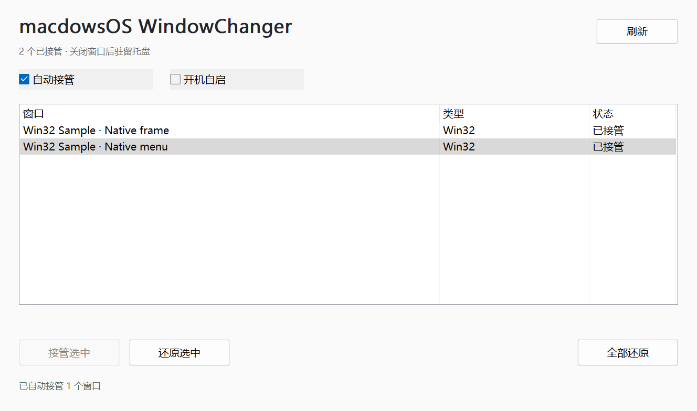

# v31：精简界面、托盘、自启、自动接管与分发

2026-11-03。未使用 computer use；仅通过自有原生测试程序、Win32 协议和临时计划任务验证。不注销、不重启系统、不关闭或重启用户应用。

## 交付行为

删除 UI 中的实验标语、测试窗口启动、截图审计、PID/详细运行时说明；保留窗口列表、接管/还原、全部还原、刷新，以及自动接管/开机自启两个开关。关闭或最小化驻留托盘，托盘可以唤回、暂停、还原并退出；再次启动只唤回已有实例。实际渲染检查包括最小尺寸所有控件可见，并修正了边框宽度导致的多余横向滚动条。



托盘使用程序生成的三灯图标。Explorer 通常为中完整性，而控制器为高完整性；仅放行托盘回调和 `TaskbarCreated`，不放行任意 `WM_COMMAND` 或测试协议。模拟丢失图标后经过真实事件处理器重新 `NIM_ADD`，不实际重启 Explorer；重复通知可用 `NIM_MODIFY` 修复。

开机自启使用当前 SID 的交互式登录任务、最高权限、后台参数，未保存密码。开关实时检查任务状态，只允许修改带本程序标记的任务；同名外部任务拒绝覆盖/删除。配置自动接管偏好按用户保存，开机自启不会在首次启动时偷偷启用。

自动接管对新窗口保留初始化宽限，对最小化窗口延后；失败按 5 秒起步、最长一分钟退避，不再永久忽略暂时未就绪的窗口；每轮限制两个附加操作。手动还原被排除到下一次明确恢复自动模式，全部还原同时暂停。队列只负责发现/重试，不跟随或写入窗口布局。

## 验证结果

- 纯契约 **21/21**：初始化宽限、退避/上限、手动排除、PID/HWND 复用、最小化延后、清理、设置持久化及真实用户配置不变；损坏或不可读取的设置不默默启用接管。
- 四种配置（x64/x86、Release/Debug）的原生生命周期各 **44/44**；完整包 x64 控制器自动接管 x86 自有窗口也为 **44/44**，核对实际辅助进程来自包内 `x86` 目录。
- 各轮包含托盘真实注册、后台启动、关闭驻留、唤回、单实例、TaskbarCreated 恢复、最小尺寸布局、暂停/恢复、手动排除、退出及控制器崩溃恢复。
- 计划任务由 Task Scheduler **实际执行**并拉起后台托盘实例，回读登录触发器、交互令牌和最高权限，随后关闭并删除临时任务和测试设置。未做真实重启/登录测试，不能将其声称为已重启验证。
- 完整包的真实框架自动接管：MFC/BCG、Office NetUI、TXGui 各 **10/10**；实际原绘制三色、自动选择、匹配架构辅助进程、暂停/撤销和原窗口状态恢复全部通过。
- 全量 CTest：x64 Release/Debug 各 **13/13**，x86 Release/Debug 各 **9/9**。新增源码共计主目录/SDK **59** 项格式检查通过，新 PowerShell 语法检查通过。
- VS 工程与 filters 各 **180** 个存在且匹配的显式文件项，无重复或通配符。

证据在本机 `out/live-v31/controller-matrix-final/result.json`、各配置 `native.log`、`ctest-*.log`、`package-integrity.json`。真实窗口/桌面库存及历史截图不上传公开仓库，公开图片仅包含控制器与自有测试窗口。

初期验证记录保留：单实例第二进程退出早于异步唤回完成，验证器改为等待完整可见条件；Office 像素检查曾误用 TXGui 的诊断参数范围，统一为两者都支持的参数后重跑通过。没有删减失败断言或把初次失败当通过。

x86 Release 首轮旧 `cross_process_style` 出现侧边/底边像素断言失败；未改动原断言，完整重跑 9/9 通过，初始日志保留，未将原因武断归于本轮控制器修改。

## Git 与运行包

旧 Git 元数据位于子目录，只跟踪旧 VS 入口。本轮保留两条既有提交历史，将元数据提升到工作区根，并在 `out/git-metadata-backups` 保留原元数据备份。远程改为重命名后的 `https://github.com/aiboqiao6/macdowsOS-WindowChanger.git`，默认分支 `master`，使用既有作者身份，不改全局配置。Git 连接依照本机已启用的系统代理做仓库局部配置，未关闭 TLS 校验。

新增忽略规则防止构建目录、凭据、私钥、缓存、二进制包与真实应用截图入库。原 GPLv3 授权保留。GitHub Actions 构建四配置、运行确定性契约并生成完整包；涉及真实交互桌面/管理员计划任务的矩阵在本机单独验证，不冒充 CI 自动执行。

日常包 `out/WindowChanger-v31.zip` 仅含运行文件、框架模块、x86 辅助程序、VC++ 可再发行库及授权/说明，不包含测试工具。已解压回读全部 **50** 项文件 SHA-256，零不匹配。源码与原树后端的有限支持边界不变，详见[运行说明](release-v31.md)和[原树适配范围](original-frameworks.md)。

```powershell
.\build.ps1 -Test
.\build.ps1 -Architecture Win32 -Test
.\demos\window-styler\package-original-frameworks.ps1
# 管理员 PowerShell：临时测试任务和自有窗口，完成后自动清理
.\demos\window-styler\research\verify-controller-matrix.ps1
# 本机真实三类窗口已开启且每类恰好一个空闲 HWND 时
.\demos\window-styler\research\verify-controller-matrix.ps1 -RealFrameworks
```
